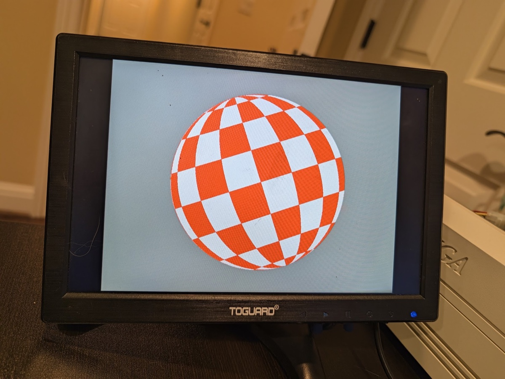

# Amiga PCI initialization libraries

Two native AmigaOS libraries and a command-line tool for running the x86
option ROM of a PCI card on a 68020 or later Amiga with AmigaOS 3.0 or later
and an OpenPCI bus board:

- `x86emu.library` runs bounded x86 CPU contexts through caller-supplied
  memory, I/O and interrupt callbacks.
- `pciinit.library` loads and validates PCI option ROMs from a file or from a
  card, runs them against the card through `openpci.library`, and keeps the
  initialized BIOS available for VBE mode queries, mode setting and
  framebuffer access.
- `PCIoprom` scans the PCI bus, loads each card's ROM or a supplied file,
  runs its initialization and reports the result. It can list and set VBE
  modes and draw a test picture.



`PCIoprom --mode 0x114` on an Amiga with an ELSA Winner 1000 Trio/V (S3
Trio64V+): the card's own VBE 1.2 BIOS set 800x600 in 16-bit colour, and the
ball went through the banked VGA window.

## Requirements

- `openpci.library` version 14 or later; openpci 40.16.1 is the tested
  provider.
- A bus board whose `ObtainPCIRegion` reaches PCI memory `A0000-BFFFF`,
  where a VGA card decodes its frame buffer during POST: Prometheus
  FireStorm, Firebird, Mediator, or AmigaPCI with current logic. On the
  original Prometheus and the G-REX the ROM still runs, but that area reads
  as zero, writes are dropped, and `PCIoprom` prints a warning.
- `ReserveMemSpace 0xC0000` in `ENVARC:PCI-Configuration`, so that no BAR is
  allocated into the legacy VGA area.
- `mathieeedoubbas.library`. `PCIoprom` switches to its own 128 KiB stack when
  the Shell's is smaller.

The card must not be in use by another driver while its ROM runs. POST
changes VGA registers and VRAM. No card resources are relocated and no bus
mastering or DMA is enabled.

## Build

Requirements: `m68k-amigaos-gcc` with AmigaOS headers and libnix, a host C
compiler, Python 3, and Vamos for the 68020 tests. The OpenPCI SDK is
expected at `~/git/OpenPCI/Include`, the `Include` directory of
[openpci68k.lha](https://aminet.net/package/driver/other/openpci68k) from
Aminet; override `OPENPCI_SDK` if it is elsewhere. The vendored libx86emu
builds without downloads.

```sh
make
make check
```

The outputs are `build/x86emu.library`, `build/pciinit.library` and
`build/PCIoprom`. `x86emu.library` translates x86 code into 68020 code by
default; `build/nojit/x86emu.library` is the same library with the
interpreter alone, and `make X86_BACKEND=libx86emu` makes that the main
build. `make release` packs them with the SDK headers and
documentation into `build/release/pciinit-<version>.lha`; see
[docs/release.txt](docs/release.txt) for the archive contents and
installation. The `pciinit.library` version and the archive name come from
the nearest `v<version>.<revision>` git tag, such as `v2.4`, `v2.4.1` or
`v2.4-rc1`; `make version` prints them and `RELEASE_VERSION=` overrides
them. AmigaOS versions have no third number, so a package number or suffix
follows the date in the library ID string. Pushing such a tag builds and
tests the archive and attaches it to a draft GitHub release; running the
release workflow by hand with the Aminet option uploads a checked release
to Aminet.

The sources follow the `.clang-format` style in the repository root:
`make format` applies it and `make check-format` verifies it
(`CLANG_FORMAT=` names the binary if it is not on the path).

## Usage

Install both libraries in `LIBS:` and `PCIoprom` on the command path. The
release also carries `x86emu.library_nojit`, an interpreter-only build that
is slower but generates no code; rename it to `x86emu.library` to use it.

```text
PCIoprom
PCIoprom path:card-rom.bin
PCIoprom --no-post
PCIoprom --no-post --dump RAM:card.rom
PCIoprom --list-modes
PCIoprom --mode 0x111 --mode 0x114 --mode 0x111 --pattern
PCIoprom --trace
PCIoprom --services
PCIoprom --release-vga
PCIoprom --log RAM:access.log --mode 0x111
```

Without arguments `PCIoprom` runs every card's own ROM. A file argument is
used instead of the card ROM for the card whose PCI vendor and device it
names. `--no-post` only loads and checks the ROMs, and `--dump` saves the
first card's ROM as read from the card. `--list-modes` queries
the installed BIOS; repeated `--mode` options set modes in order, in decimal
or `0x` hexadecimal, and `--pattern` draws and verifies colour bars after
each. Direct-colour modes show a Boing Ball by default. A ROM-advertised
linear framebuffer is mapped and drawn directly; a banked mode, which is
all a VBE 1.2 ROM offers, is drawn through the legacy VGA window when the
bus board provides one, and otherwise the program says why nothing was
drawn. `--trace` adds the last 128 I/O, VGA, BAR and interrupt accesses of
each ROM run or failed BIOS call to the CPU summary. `--services` lets BIOS
services that neither the ROM nor the library provides fail instead of
stopping the run, and lists each one afterwards. After each ROM run a
`LEGACY` line says whether the ROM used the VGA ports, other I/O ports and
VGA memory. When a card cannot run because another display card answers
the VGA ports, the program names that card. `--release-vga` turns each
card's VGA port and memory decode off after use, so the next card can
have them. `--log` writes every card access of each POST and BIOS call to
a text file: port, VGA memory, BAR and configuration reads and writes in
order, with the values, and with repeated accesses (polling loops) and
fills folded into one line each. Runs with `--log` are slower. The last
mode stays on the display when the program exits.

The exit code is 0 when every attempted initialization succeeded, 5 when a
POST could not run or no usable ROM was found, and 20 on errors.

An optional `PCIoprom-Configuration` file, read from `ENV:` and otherwise
from `ENVARC:` (or from the file named with `--config`), excludes cards
from ROM execution. One command per line, `;` starts a comment:

```text
Ignore 5333:5631   ; this vendor and device
Ignore 121a:*      ; every device of this vendor
```

Vendor and device are hexadecimal. Ignored cards are listed and skipped
entirely; a rejected line is reported and the rest of the file still
applies.

Known ROM images, identified by the CRC-32 of their initialization code,
receive documented byte patches in RAM before they run (see
`src/pciinit/quirks.c`); `PII_Quirks,0` on `CreatePCIContext()` runs an
image unpatched. The card ROM itself is never written.

## Documentation

- [docs/abi.md](docs/abi.md): the two library ABIs, statuses, tags and the
  framebuffer contract.
- [docs/ARCHITECTURE.md](docs/ARCHITECTURE.md): design, boundaries and the
  bus board address spaces.
- [fixture/README.md](fixture/README.md): the WinUAE guest fixture used for
  native testing.

Public headers are under `include/`, library vector descriptions under
`fd/`.

## License

Original project code is licensed under the [BSD 2-Clause License](LICENSE).
Vendored libx86emu code retains its upstream licenses and notices in
`third_party/libx86emu/LICENSE` and `LICENSE_INFO`; the project license does
not replace those terms.
