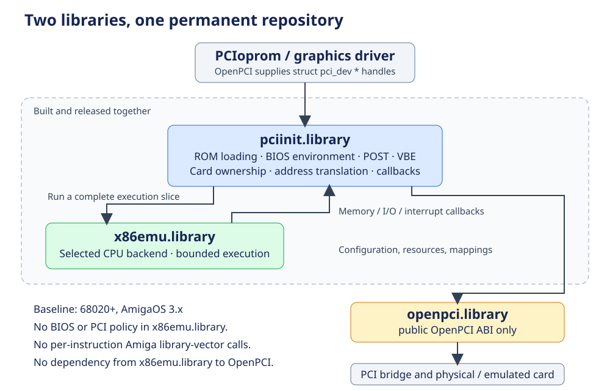
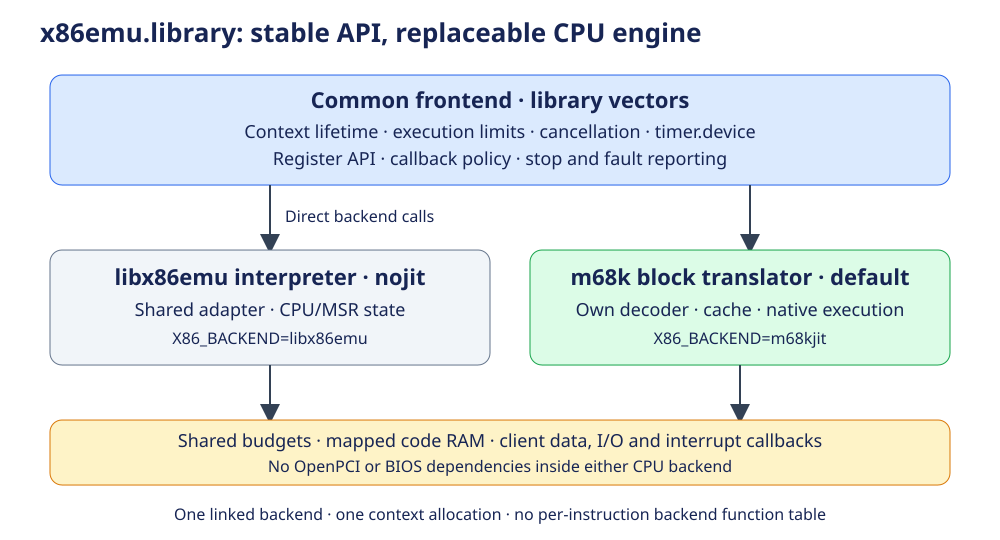
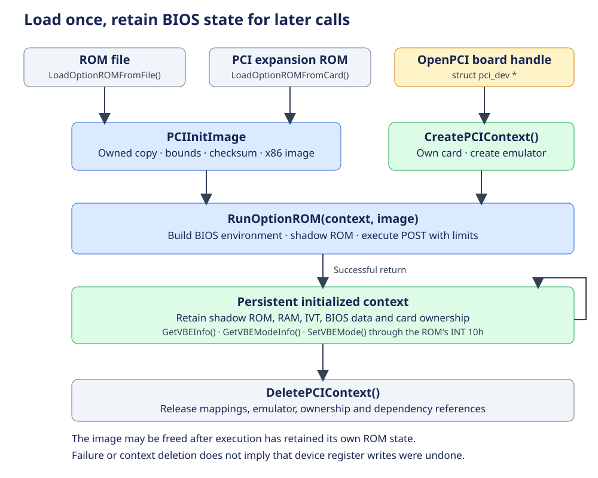
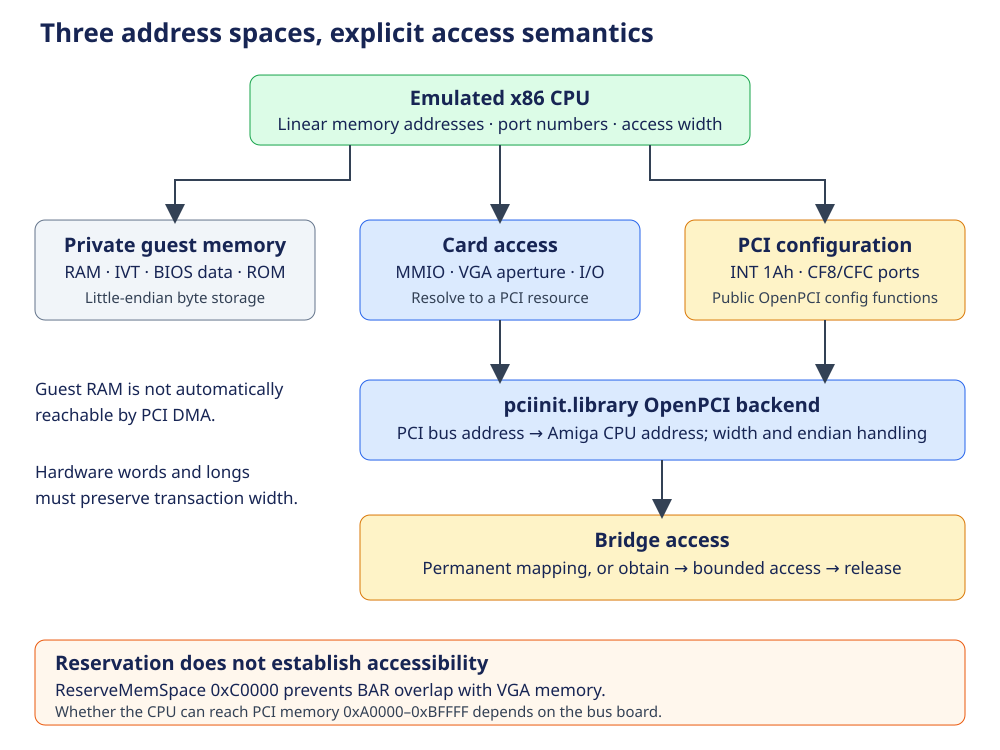
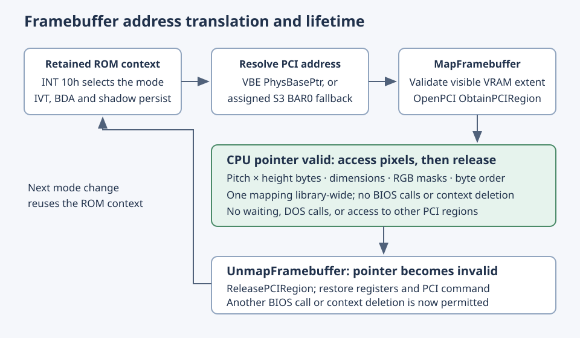

# Architecture

The project builds two Amiga shared libraries and a command-line tool:

- `x86emu.library`: a reusable x86 instruction emulator.
- `pciinit.library`: a PCI option ROM execution environment and BIOS-service
  interface, using `x86emu.library` and `openpci.library`.
- `PCIoprom`: card discovery, ROM execution and graphics tests.

They need a 68020 or later and AmigaOS 3.0 (Exec/DOS V39), with no FPU or
MMU requirement. Graphics initialization and VBE mode setting are the
supported use; the loader and execution context also accept other legacy
x86 PCI ROMs, without promising that every card's firmware finds the BIOS,
interrupt or DMA support it expects. EFI-only ROMs, an RTG driver and a
BIOS-backed disk device are out of scope. The ABI is specified in
[abi.md](abi.md).

## Library boundaries



### x86emu.library

The emulator owns CPU execution and per-instance emulator state: context
creation and destruction, register snapshots, memory and I/O callbacks,
interrupt interception, bounded execution and stop reporting. It has no
dependency on OpenPCI and knows nothing about PCI enumeration, ROM
selection, BIOS services or VBE, so other programs can use it on its own.

A library call starts one bounded execution run. Instruction dispatch and
arithmetic stay inside the emulator; memory, I/O and interrupt callbacks
call the client's handlers directly, never through a library vector per
instruction. Handles are opaque and the upstream `x86emu_t` never leaves
the library. Register snapshots and callback descriptors use fixed-width
fields and carry their size.

Each context is allocated independently and runs one execution at a time;
re-entering the same context from a callback is rejected. Contexts share no
mutable CPU or guest-memory state, and callbacks run synchronously in the
calling task.

### Executable RAM mappings

`X86Config` takes up to eight nonoverlapping `X86CodeRegion` descriptors.
Descriptors are copied, but their ordinary RAM/ROM storage must remain
valid until the context is deleted. Concurrent modification during a run
is forbidden. Guest writes and synchronous callbacks may change code.

Mapped instruction fetches bypass the client callback while retaining the
same access-budget accounting. The mapping promises that fetching those
bytes has no side effects; it must never describe PCI apertures or MMIO.
Backends observe code changes before executing subsequent instructions
after a callback. Data accesses go through the scalar callback unless the
region is marked in `data_regions`, in which case the engine reads and
writes the RAM directly, or a bulk or scan callback handles a string
instruction.

`pciinit.library` maps its owned RAM below `0xA0000` and from `0xC0000` to
`0x100000`, leaving the VGA aperture callback-only. The first two regions
are data regions; the one above `0xF0000` stays fetch-only so its write
rejection remains in the callback.

### Bounded string transfers

The optional bulk callback receives real-mode REP MOVS/STOS on both CPU
backends. A request stops before segment, index and access-budget
boundaries and holds at most `bulk_elements` elements, up to 65,536. The
engine polls cancellation and timeout once per request and accounts the
completed elements afterwards. Every callback completes the prefix it can
prove instead of declining a request whose later elements leave an
aperture, RAM range or 32 KiB VGA slice; after a decline the engine runs
scalar accesses up to the next 256-access polling boundary.

`pciinit.library` declares the full span, so a 64 KiB REP STOS reaches the
VRAM transport as one request. It uses the callback for disjoint RAM
copies, RAM fills, and forward stores into the legacy VGA window, where
every element is stored with the guest's width so the card applies its own
write mode. Reverse copies and overlaps retain scalar execution.
Diagnostic counters and the trace ring retain the same logical accesses.

The optional scan callback handles REP SCAS in prefixes of at most 256
elements, stopping at the first comparison which fails the REP condition,
and returns its final read value. The engine retains flags, index/count
updates, access accounting and polling. The hardware transport reads the
legacy window element by element until the comparison ends the repeat.
Diagnostic and recording runs keep individual read callbacks.

### CPU backend boundary



`src/x86emu/engine.c` implements the common context/register API, allocation,
timer lifetime, busy guards and execution reporting. The private contract
in `include/private/backend.h` contains no upstream CPU types. It provides
shared instruction/access checks and interrupt policy, plus directly
linked backend operations for initialization, destruction, register access,
execution and stopping. Hot instruction/access checks are inline; there is
no per-instruction backend function table.

Two backends exist; the build links one. The block translator
(`m68kjit.c`) is the default, and `make X86_BACKEND=libx86emu` builds the
reference interpreter alone (`libx86emu.c`). Every build also produces the
interpreter library as `build/nojit/x86emu.library`, which the release
ships as `Libs/x86emu.library_nojit` for systems that should not run
generated code. Both backends use the shared adapter in
`libx86emu_adapter.c`, which owns the complete CPU/MSR state and connects
memory, instruction and interrupt callbacks. Backend storage shares the
context allocation and is aligned for pointers and 64-bit integers.

The block translator has its own block decoder, cache, emitter and
execution loop, and adds no hook to the vendor execution loop. It emits
native 68020 code for real-mode register operations, port I/O and
branches, reusing the interpreter's arithmetic helpers for flags. Other
real-mode instructions cache their opcode and prefix decoding and call the
interpreter's semantic handler. Operands are still fetched at execution,
and faults and interrupts use the upstream delivery machinery. Both paths
operate on one complete CPU state. Clients without executable mappings run
entirely in the interpreter, as do protected-mode and 32-bit code segments.

Blocks contain at most 16 guest instructions. Port I/O ends a block;
fetches and instructions are accounted before the client callback, and
cached bytes are compared before each reuse, so writes through the client
or the guest are visible at the next block entry. Generated code is
context-owned and synchronized with `CacheClearU()`. Instruction and access
limits remain exact: a block that would exceed a budget falls back to
instruction stepping. Cancellation and timeout are checked at block
boundaries; the timeout check reads the timer request's reply state inline.
The cache has 1,024 slots of 1 KiB, so a JIT context takes about 1 MiB
against about 20 KiB for the interpreter.

### pciinit.library

This library owns the firmware environment and the relationship to a PCI
card: ROM images, card contexts, BIOS data, interrupt dispatch, hardware
access translation, ownership, POST and VBE calls. It uses only the public
OpenPCI ABI and holds its dependency libraries open for as long as its
objects need them. Live contexts and images prevent expunge; callers keep
the library open until their objects are released.

## Emulator source

`third_party/libx86emu` is a pinned snapshot of
[libx86emu](https://github.com/wfeldt/libx86emu) at commit
[`ce81129c57fdfbf690bebc210a8db97d926cc5e7`](https://github.com/wfeldt/libx86emu/commit/ce81129c57fdfbf690bebc210a8db97d926cc5e7)
(2025-02-24), with its notices and a record of the local changes. It is
compiled into `x86emu.library`; builds never fetch it. Amiga builds omit
the upstream instruction text and I/O statistics. Original project code
uses the [BSD 2-Clause License](../LICENSE); vendored code keeps its own.

## Public objects and ownership



### Board handles

The board argument is an OpenPCI `struct pci_dev *` from `FindBoardA()` or
another public OpenPCI enumeration call. The library reads identity and
resources through public attributes. OpenPCI's `base_address[]` and
`rom_address` fields hold Amiga CPU addresses and its size fields hold
masks; neither is a PCI bus address or a byte length. The board's OpenPCI
instance stays open, and resources are not reconfigured while a context
is active.

### ROM images

`PCIInitImage` is an opaque, library-owned ROM image with bounded storage,
source metadata and the parsed image chain. Loading does not POST the
card, and loading a file does not select a device. Loading from a card
takes exclusive access, enables ROM decoding, copies the bytes, restores
the ROM and command registers and releases the card; it fails if another
client owns the card.

### Card execution contexts

`PCIInitContext` owns a card and its persistent firmware environment: an
emulator context, private RAM, IVT, BIOS data, shadow ROM, resource
translation, execution limits and diagnostics. It obtains the card through
OpenPCI and keeps it until deletion, including between VBE calls. A card
already owned by another driver is refused.

POST runs from the context's own shadow copy, so freeing the loaded image
cannot invalidate installed interrupt handlers or firmware data. The
shadow and guest memory remain after a successful POST.

```c
image = LoadOptionROMFromCard(board, tags);
/* Alternatively: image = LoadOptionROMFromFile(path, tags); */

ctx = CreatePCIContext(board, tags);
status = RunOptionROM(ctx, image);

status = GetVBEInfo(ctx, &info);
status = GetVBEModeInfo(ctx, mode, &mode_info);
status = SetVBEMode(ctx, mode, flags);
status = GetCurrentVBEMode(ctx, &current_mode);
status = MapFramebuffer(ctx, &framebuffer);
/* Access pixels only while mapped. Check every result. */
status = UnmapFramebuffer(ctx);

DeletePCIContext(ctx);
FreeOptionROM(image);
```

A context is created, executing POST, initialized or failed. Only an
initialized context accepts VBE calls, and POST runs once per context. An
execution failure releases transient mappings and records the stop reason;
the context stays deletable and keeps its card until then. Hardware writes
made before a failure are not rolled back.

## ROM validation and execution

The loader checks bounds before reading any structure or following an
offset: signatures, declared lengths, PCIR structures, image-chain
progress and checksums. It selects the legacy x86 image from a multi-image
ROM and reports EFI-only and other formats as unsupported. Allocations and
chain traversal are bounded independently of the ROM's length fields.

Card loading uses the OpenPCI-assigned ROM resource and never sizes or
moves live BARs. A file image must match the selected card before it runs
on hardware.

POST sets up the entry registers, PCI identity, stack and return address.
A return trampoline tells normal completion apart from an unexpected HLT,
an invalid instruction, a bad memory access or a limit stop. Execution
runs in task context with instruction, access and time limits and a
cancellation path, which also bound long REP operations and callback work.
Neither `Forbid()` nor disabled interrupts are held during a run.

## BIOS environment

Each context has private guest memory with a conventional-memory layout,
IVT, BIOS data area, stack, ROM shadow and minimal system-BIOS entry
points. Memory-size reports match the allocated layout.

| Facility | Provided |
| --- | --- |
| INT 1Ah | PCI BIOS configuration services and the time-of-day tick |
| INT 10h | Bootstrap services until the ROM installs its own video handler |
| INT 11h / 12h | Equipment and conventional-memory reports |
| INT 15h / 16h | Failure status and an empty keyboard, as on a bare PC |
| Platform ports | PIT channels 0 and 2 and port 61h for delay loops; DMA page registers 80h-8Fh are latches |

Interrupt dispatch separates library services from handlers the firmware
installs, with normal chaining and return. VBE runs through the graphics
ROM's own INT 10h handler. Services with a defined failure convention
return failure; anything else stops the run with a diagnostic rather than
inventing success. PC platform ports are never forwarded to unrelated PCI
devices.

## Address translation and PCI access



Three address domains stay separate: x86 guest linear addresses, PCI bus
addresses and Amiga CPU addresses. A guest pointer is never an Amiga
pointer. Guest RAM uses little-endian helpers and allows x86 unaligned
accesses without unaligned 68k loads and stores.

An access resolves to guest RAM, shadow ROM, the selected card's
resources, legacy VGA memory, port I/O or platform emulation. Hardware
accesses keep their transaction width, volatility and the bridge's byte
order; a word or long transaction is never split into byte operations.

PCI BIOS configuration calls and CF8/CFC accesses share one identity and
policy model. Assigned BARs are preserved: resource probes and relocation
are refused, configuration writes are limited to the selected card's
supported operations, and other devices read as absent. PC IRQ routing and
bus-master/DMA facilities are not offered.

### Mapping lifetime and concurrency

OpenPCI's `ObtainPCIRegion()` takes a PCI address and returns an Amiga
address. Only one temporary region may be held at a time; other PCI
mappings can become inaccessible while it is, and some bridges disable
interrupts for its duration. The library therefore obtains a region,
performs a bounded operation and releases it before resuming guest
execution, calling out or yielding, and never keeps a pointer after the
release. Card ownership is not a bridge-wide lock, so callers serialize
their hardware operations.

### Legacy VGA window

`ENVARC:PCI-Configuration` must contain:

```text
ReserveMemSpace 0xC0000
```

This keeps BAR allocations out of the classic VGA area, including
`0xA0000-0xBFFFF`. Reserving the range does not make it reachable from the
CPU; that depends on the bus board. The Prometheus FireStorm and the
Firebird boards that carry its logic place configuration and I/O at the
top of their window, the Mediator reaches PCI address 0 through its bank
register, and AmigaPCI provides the legacy window at `$9FF00000` with
current logic. The original Prometheus decodes the first megabyte of its
window as I/O and configuration space, and the G-REX passes CPU addresses
through unchanged, where that range is chip RAM; neither can reach PCI
memory `0xA0000`.

There is one generic transport and no per-card alternative: legacy VGA
memory accesses reach the card with their planar, chain-4 and text-mode
semantics intact, independently of BAR access.

## Graphics interface

The library provides controller and mode queries, mode setting and
current-mode readback through the retained ROM handler. Returned far
pointers and geometry are validated before use; applications receive
native structures with dimensions, pitch and pixel masks.

A framebuffer mapping needs a ROM-provided VBE 2.0+ linear mode whose
address lies in one of the card's memory BARs. A VBE 1.2 ROM offers only
banked modes: they can be set, `MapFramebuffer` reports
`PI_UNSUPPORTED_MAPPING` for them, and `WriteFramebuffer` and
`ReadFramebuffer` move their pixels through the VGA window bank by bank
where the bridge provides that window.

`MapFramebuffer` returns the CPU address, resolved PCI address, visible
byte extent, actual pitch, RGB masks and pixel byte order. The mapping
must be released with `UnmapFramebuffer` before another BIOS call or
context deletion. Only one mapping exists library-wide, and because the
OpenPCI window may block interrupts, clients access pixels and release it
promptly, without OS waits or other PCI access. Unmapping restores the
temporary register changes.



See [the ABI](abi.md#framebuffer-access) for the flags and failure
behavior.

The graphics ROM sets modes; rendering, acceleration and Picasso96
integration belong to a graphics driver. A driver can keep its firmware
context for later mode changes or delete it after its last BIOS call.
Deletion leaves the last mode on screen.

## PCIoprom

```text
PCIoprom
PCIoprom path:card-rom.bin
PCIoprom --no-post
PCIoprom --no-post --dump ram:card.rom
PCIoprom --list-modes
PCIoprom --mode 0x111 --pattern
PCIoprom --mode 0x111 --mode 0x114 --mode 0x111 --pattern
```

PCIoprom scans all cards, loads each matching ROM, runs POST and reports
the result. `--no-post` stops after the loader and preflight checks, and
`--dump` writes the first card ROM, as read through the bridge, to a file.
A ROM file is matched to a card by PCI vendor and device.

Mode options initialize a context and run every operation within that
invocation. Direct-color modes show a centered red-and-white Boing Ball on
gray, about 80% of the screen height. Lookup tables are prepared before the
framebuffer is mapped, and rendering uses integer arithmetic and respects
the pitch and pixel masks. Indexed modes are set without drawing. Up to 16
modes may be selected. `--pattern` draws RGB color bars and a gradient
after each mode change and reads them back. The program unmaps and deletes
the context before it exits, leaving the final mode on screen.

## Repository layout

```text
docs/                          ABI, architecture and diagrams
include/libraries/             Public types and constants
include/clib/                  Public function prototypes
include/proto/, include/inline/  Compiler-facing library includes
fd/                            Library vector definitions
src/x86emu/                    Emulator frontend and CPU backends
src/pciinit/                   ROM, BIOS, PCI, VBE and lifecycle code
src/pcioprom/                  PCIoprom
src/runtime/                   Library startup and memory allocation
third_party/libx86emu/         Pinned emulator snapshot
tests/                         Host and 68020 tests
tools/                         Release packaging and the WinUAE test harness
fixture/                       WinUAE harness patches
```

One build produces both libraries, the SDK headers and PCIoprom. The two
libraries are versioned independently; `pciinit.library` opens the
emulator and OpenPCI versions it needs and fails cleanly without them.
Card ROMs are never bundled.
